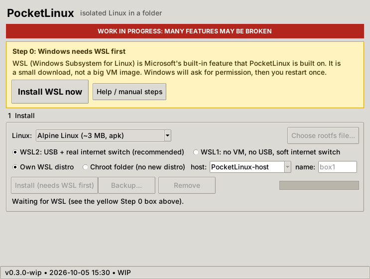
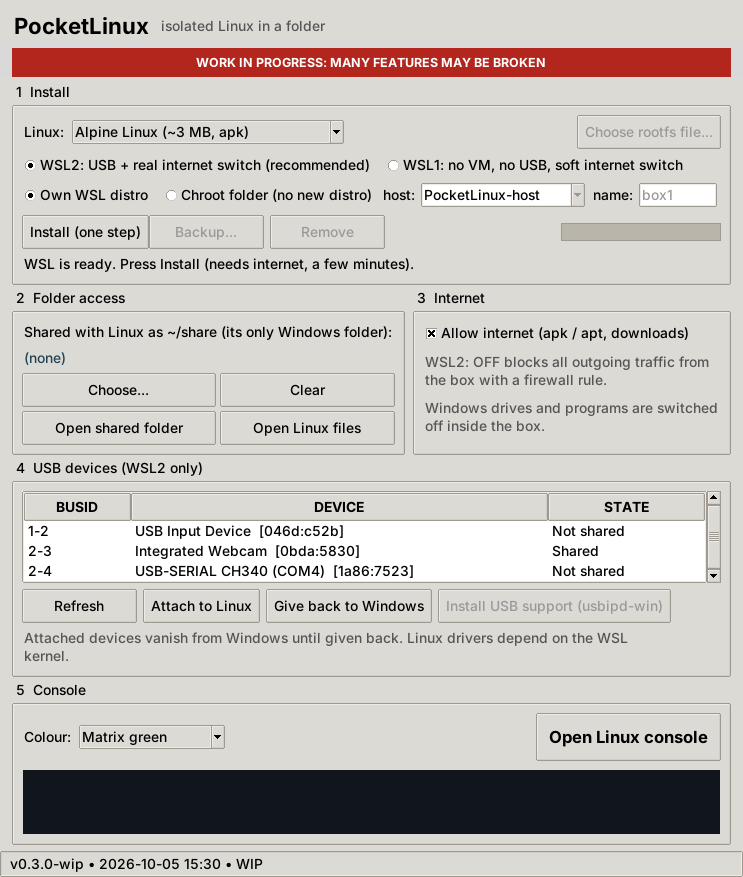

# PocketLinux

**WORK IN PROGRESS: MANY FEATURES MAY BE BROKEN** (0.3.0-wip, proof of concept)

> Source-available, non-commercial: [PolyForm Noncommercial 1.0.0](LICENSE.md). Provided as is, with no warranty and no liability. Not legal advice.
> **Not tested on a real Windows PC yet.** It was built in a Linux sandbox. Unit tests, a simulated "demo" mode, and the chroot/unshare scripts (run for real on Linux against a tiny root) were exercised; real `wsl.exe` and `usbipd` calls were not.

A tiny, isolated Linux console that lives in a Windows folder. No multi-gigabyte VM image: it imports a ~3 MB Alpine Linux root filesystem (or Debian slim, ~30 MB) into Windows Subsystem for Linux (WSL), switches off everything that links it to Windows, and gives you a launcher with:

1. **One-step install** into the `data` folder next to the app.
2. **Folder access**: exactly one Windows folder is shared into Linux as `~/share`; you can also browse and edit the Linux files from Windows Explorer.
3. **Internet switch**: allow or block the box's outgoing network (for `apk` / `apt`).
4. **USB picker** (WSL2 + [usbipd-win](https://github.com/dorssel/usbipd-win)): attach or give back a USB device.
5. **A separate, colour-themed console window** that is visibly not your normal Windows terminal.





*Screenshot is from the demo mode with made-up USB devices.*

## Quick start

1. Unzip anywhere you like (a USB stick works for the app; the Linux files go into `data\rootfs` beside it, so do not move the folder after installing, use **Backup** instead).
2. Double-click **`Start.cmd`**. If Python is missing it offers to install it with winget.
3. If a yellow **Step 0** box appears, WSL is not set up yet: press **Install WSL now**, approve Windows' permission prompt, then **Restart Windows now** and open PocketLinux again. The rest of the window stays hidden until WSL works, and the box also tells you what to do if WSL is installed but not answering (help, `wsl --update`, Windows-features method).
4. Pick Alpine (smallest) or Debian, choose **WSL2** (USB + real firewall) or **WSL1** (no VM, no USB), press **Install**.
5. Choose a shared folder, then press **Open Linux console**.

Is WSL itself a multi-GB download? Not as far as we know: the feature is small and WSL1 needs no Linux kernel; the big downloads are Store distros like Ubuntu. Alpine's root filesystem is about 3 MB.

## Two layouts: own distro or chroot folder

| | Own WSL distro | Chroot folder |
|---|---|---|
| What is created | a new WSL distro `PocketLinux` (one registry entry) | a plain folder `/opt/pocketlinux/<name>` inside a host distro |
| Your other WSL distros | untouched | **untouched** (an existing host is never modified; only a folder is added) |
| Host | itself | the tiny `PocketLinux-host` (~3 MB Alpine, created once) **or any distro you already have** (needs `unshare`, `chroot`, `tar`) |
| Isolation | `wsl.conf`: no Windows drives, no interop | own mount, PID, hostname and IPC namespaces; the share and `/dev` are bind-mounted only inside it and vanish when the console closes |
| Internet OFF | firewall rule (WSL2) / DNS only (WSL1) | the console gets an **empty network namespace**: no network at all (applies next time the console opens) |
| WSL version | 1 or 2 | 2 only |
| Remove | unregisters the distro | deletes just that folder (refuses if anything is still mounted under it) |

Several chroots can share one host: give each a different *name*. The chroot lives on the host's Linux disk, not on NTFS, because Linux root filesystems need symlinks and permissions that Windows folders cannot reliably hold. Use **Backup** to export it as a `.tar` to Windows, or **Open Linux files** to browse it at `\\wsl.localhost\<host>\opt\pocketlinux\<name>`.

## WSL1 or WSL2?

| | WSL1 | WSL2 |
|---|---|---|
| VM | none (syscall translation) | small utility VM |
| USB | no | yes, via usbipd-win |
| Internet switch | DNS only (advisory) | firewall rule (OUTPUT drop) |
| Disk | files in `data\rootfs` | one `ext4.vhdx` in `data\rootfs` |

## What "isolated" means here

PocketLinux writes `/etc/wsl.conf` inside the distro with automount off, Windows interop off and the Windows `PATH` off, so Windows drives and programs are not available from the Linux shell. Only the folder you choose is mounted. **This is configuration, not a security sandbox.** WSL2 distros share one VM, Windows can always open the Linux files through `\\wsl.localhost\PocketLinux`, and the Linux user has passwordless `sudo`. See [docs/HOW_IT_WORKS.md](docs/HOW_IT_WORKS.md).

## Known limitations

| Item | Status |
|---|---|
| Real WSL import, share mount, firewall, usbipd calls | **Unverified** on real Windows |
| WSL install (`wsl --install --no-distribution`, DISM fallback), restart and state detection | **Unverified** on real Windows; state is detected by exit code (Windows' messages are translated), so odd setups may show the wrong Step 0 box. Needs Windows 10 2004 (build 19041) or newer / Windows 11. Admin approval is required and company-managed PCs may block it |
| Virtualization check (BIOS) | Best effort; shows a warning only when Windows reports it as off |
| Alpine download | URL layout assumed (`latest-releases.yaml`); could not be fetched from the build sandbox |
| Debian download | URL not verified; use *Custom rootfs file...* if it fails |
| USB drivers | Depend on the WSL kernel; webcams and some adapters may need a custom kernel |
| Raw Linux disk (ext4) mounting | Not included; `wsl --mount` can do it (WSL2, admin) |
| Chroot layout on a host you already own | Needs `unshare`, `chroot`, `tar` there; the app checks and tells you, it never installs into your host |
| Chroot internet switch | Applies when the console is next opened, not to a console that is already open |
| Chroot console user | Starts as `dev` (passwordless `sudo`) inside the chroot; the host side runs as root |
| Folder paths containing `'` | Rejected on purpose |
| Moving the folder after install | Breaks the WSL registration; use Backup, Remove, Install elsewhere |

## Development

```
python -m unittest discover -s tests -v
python src/main.py --version
python src/main.py --demo        # fake WSL and fake USB devices, runs on any OS
```

Build date and version are shown in the title bar and status bar. Low-end hardware: tkinter only, no extra Python packages; the heavy lifting is done by WSL itself, so no C++ backend is needed.

Third-party software (WSL, Alpine, Debian, usbipd-win) keeps its own licences; this project is not affiliated with them.
